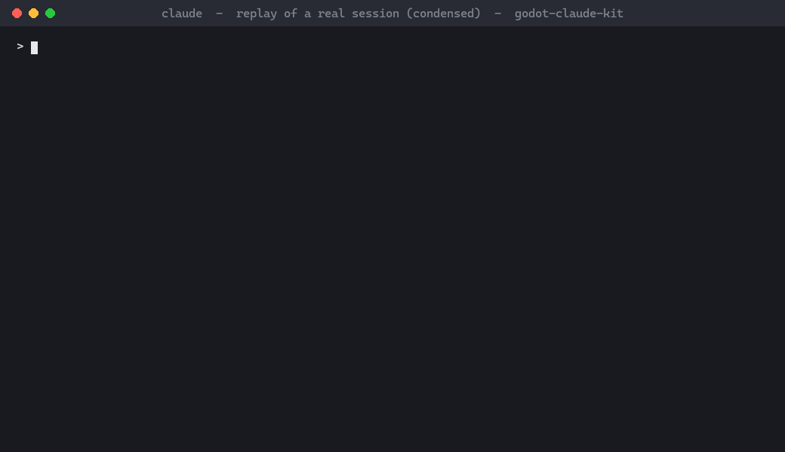

# godot-claude-kit

**Claude Code skills that make Claude actually run, test and verify a Godot 4 project, instead of trusting an exit
code.**



*A real Claude Code session, replayed and condensed. The validation in the demo's `net_match.gd` was broken on
purpose, and the prompt did not mention the kit. Claude picked the multiplayer skill on its own. It ran a real server
and a real client, got `FAIL` from both sides, and found the line.*

When an AI agent "verifies" a Godot change, it usually runs the engine headless, sees exit code 0 and reports success.
In Godot 4 that proves nothing. Every row below exits **0**:

| What happened | Exit | What the log shows |
|---|---|---|
| `--import` on a project with a hard syntax error | 0 | nothing at all |
| a scene whose own script does not parse | 0 | `SCRIPT ERROR`, then the scene runs as a bare node |
| a test harness that forgot to `await` a slow check | 0 | `PASS`, and the failing check never prints |
| a run with `--user-data-dir` (Godot 4 has no such flag) | 0 | empty: the scene never ran |
| a fresh clone run before `--import` | 0 | a false `Could not find type "<ClassName>"` |
| a healthy scene that simply prints nothing | 0 | byte-identical to the "never ran" log above |

There are also false alarms. For example, `--check-only --script` fails every *correct* script that uses an autoload.

Multiplayer is worse. Both of these leave server and client exiting 0:

- An RPC to a function without `@rpc` logs its error only on the **sending** side.
- An RPC to a node path the other side lacks logs its error only on the **receiving** side.

A client waiting for a server that is not there gives up after ~31 s.

Unit-test frameworks are not immune either. Measured with GUT 9.7.1:

- A test file that does not parse is silently dropped, and the run ends `All tests passed!` with exit 0.
- An empty or missing test directory ends `Nothing was run.` with exit 0.

gdUnit4 6.2.2 exits 0 on `No test cases found`. With `-d` and a broken test file it hangs forever at a `debug>` prompt
on Windows. On Linux it usually prints `Abnormal exit with 105` but exits 0 (3 of 4 measured runs); the fourth hung
the same way.

Screenshots are a trap of their own. `--headless` never draws a frame:

- A capture that waits for the frame to be drawn never resumes. `--quit-after` ends the run with exit 0 and no image.
- `get_image()` returns null, also with exit 0.
- `--write-movie` crashes.

A drawing run can still hand you a perfectly valid PNG of nothing, with exit 0:

- Grab the image before the frame is drawn and you get uniform black (at startup: a 4x4 placeholder on Windows, null
  on Linux).
- Shoot a 3D scene without a camera and you get uniform grey.
- Shoot a scene whose script does not parse and you get a plausible HUD over an empty world.

This kit teaches Claude to get a verdict it can trust. Every claim in the skills is reproduced on a small demo project
by [`tests/measure_traps.sh`](tests/measure_traps.sh). If a claim does not reproduce, it is not in the kit.

## What's inside

| Skill | What it gives Claude |
|---|---|
| **`godot-run`** | A runner (`godot_run.sh`). It finds the engine and isolates the run from your editor settings and `user://` data. It imports when needed, always has a `--quit-after` and wall-clock backstop, and judges the log: `PASS` / `FAIL (reasons)` / `UNVERIFIED` / `NO-ENGINE`. It also covers the Windows PowerShell pitfalls (a GUI build that returns instantly, UTF-16 logs). |
| **`godot-headless-harness`** | A **parse gate** scene that checks every GDScript compiles, with autoloads live. A **diag harness** template that drives your real scenes and autoloads, with coverage counting, so an un-awaited check cannot pass silently. A scaffold script, and the rule that every new check must be seen failing before it counts. |
| **`godot-multiplayer-harness`** | A real headless **server and client(s) as separate engine processes**, started by `net_run.sh`, which judges every process's log and passes only when all of them pass. A harness template: one scene for both roles, a short timeout on every network wait, a "client done" handshake, loopback-only binding. A static **RPC check** that every RPC the project sends lands on an `@rpc` function. |
| **`godot-unit-tests`** | Runs your **GUT or gdUnit4** tests through the runner with the flags that avoid their traps. It judges them by the framework's exit code, its **JUnit XML** (fresh every run, a missing one is a FAIL) and the lines where they exit 0 without testing: a dropped test file, nothing run, no test cases. A `--min-tests` floor counts tests that *passed*. Reports never land in your project. |
| **`godot-screenshot`** | Renders a scene to a PNG in a real window, parked off-screen (on Linux: xvfb). It fails a frame that is blank, the wrong size or comes with engine errors. It compares the frame with a **golden image**, but only one rendered by the same driver and GPU. Then Claude has to **open the PNG and say what it sees**. No capture script or scene is added to your project. |
| **`godot-ci`** | One command for the whole project: import, the parse gate, the RPC check, every `diag_*` and `netdiag_*` harness, the unit tests and the golden screenshots, with one verdict. `install` writes a GitHub Actions workflow that runs the same script on Linux. |

The skills trigger on their own. Ask Claude to "check that everything still compiles", "verify the damage fix",
"test the multiplayer hit sync", "run the unit tests", "check the HUD still looks right" or "set up CI for this Godot
project", and it picks the right one.

## Install

In Claude Code:

```
/plugin marketplace add hibi/godot-claude-kit
/plugin install godot-kit@godot-claude-kit
```

The skills are then available as `/godot-kit:godot-run`, `/godot-kit:godot-headless-harness`,
`/godot-kit:godot-multiplayer-harness`, `/godot-kit:godot-unit-tests`, `/godot-kit:godot-screenshot` and
`/godot-kit:godot-ci`. Claude also loads them by itself when a task needs them.

**Requirements:**

- Godot 4.x. The kit was measured on 4.7.2.
- `bash`. On Windows that is Git Bash, which Claude Code already uses.
- The engine binary as `GODOT_BIN`, or `godot` on `PATH`. On Windows, use the `*_console.exe` build.

## Quick start

Tell Claude:

> Add a parse gate and a health harness to this project, run them, and set up CI.

Claude will then:

1. Scaffold `res://tools/ci/parse_gate.tscn` and `res://tools/diag_<name>.tscn`.
2. Write real checks against your code.
3. Break the code on purpose to prove each check fails, then restore it.
4. Run everything through the runner.
5. Write `.github/workflows/godot-ci.yml`.

Or by hand, without Claude, from your project directory. This route needs a clone of this repository:

```bash
KIT=~/godot-claude-kit    # where you cloned it
bash "$KIT/skills/godot-headless-harness/scaffold.sh" --path . gate
bash "$KIT/skills/godot-run/godot_run.sh" --path . --banner '^PARSE-GATE: PASS' res://tools/ci/parse_gate.tscn
bash "$KIT/skills/godot-ci/ci.sh" --path .
```

## Works with MCP servers

Godot MCP servers let an agent launch the editor, edit scenes or read the console. This kit does not replace them.
It answers a different question: *did that run really prove what the agent claims?* Use both.

## Verified on

| Platform | Engine | What ran |
|---|---|---|
| Windows 10, Git Bash and PowerShell 5.1 | 4.7.2 stable, GUT 9.7.1, gdUnit4 6.2.2; screenshots on an NVIDIA GPU (Vulkan and OpenGL) | `measure_traps.sh`: every trap above, the multiplayer, test-framework and screenshot traps, and each sabotage case of the runner, gate, harnesses, `net_run.sh`, `rpc_check.sh`, `test_run.sh`, `shot.sh` and `ci.sh` |
| Linux (Debian, WSL2) | 4.7.2 stable (official Linux build), GUT 9.7.1, gdUnit4 6.2.2; screenshots under xvfb with Mesa llvmpipe | `measure_traps.sh`, the same set (the Windows-only PowerShell traps skip themselves), and the generated workflow's steps executed verbatim |
| GitHub Actions, `ubuntu-latest` | 4.7.2 stable; screenshots under xvfb with Mesa llvmpipe | the kit's own workflow on every push: `ci.sh` on the demo, including a screenshot compared with a golden rendered on that runner (`--require-shots`) |

The skills were also tested by a fresh Claude Code session with only the plugin loaded and a plain prompt. The skills
triggered by themselves, and the verdicts matched the ground truth (PASS on the clean demo, FAIL naming the broken
file).

## Repository layout

```
.claude-plugin/        plugin + marketplace manifests
skills/godot-run/      runner + skill
skills/godot-headless-harness/   parse gate + harness templates, scaffold script
skills/godot-multiplayer-harness/   net_run.sh, rpc_check.sh, netdiag template, scaffold script
skills/godot-unit-tests/   test_run.sh (GUT / gdUnit4)
skills/godot-screenshot/   shot.sh + its capture script (PNG, blank-frame check, golden compare)
skills/godot-ci/       ci.sh, GitHub Actions template
demo/                  small Godot 4 project every claim is measured on
tests/measure_traps.sh reproduces every trap; tests/sabotage/ holds the broken-on-purpose fixtures,
                       tests/fixtures/ the GUT / gdUnit4 tests it runs (the frameworks are downloaded, pinned by sha256)
```

## Roadmap

- A GDScript reviewer agent.

## License

[MIT](LICENSE)
